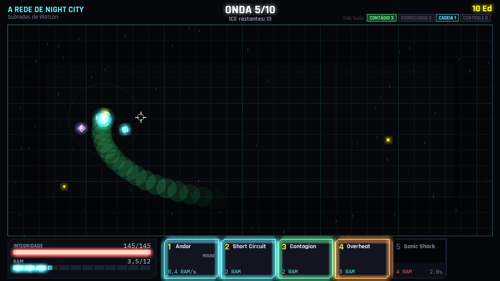
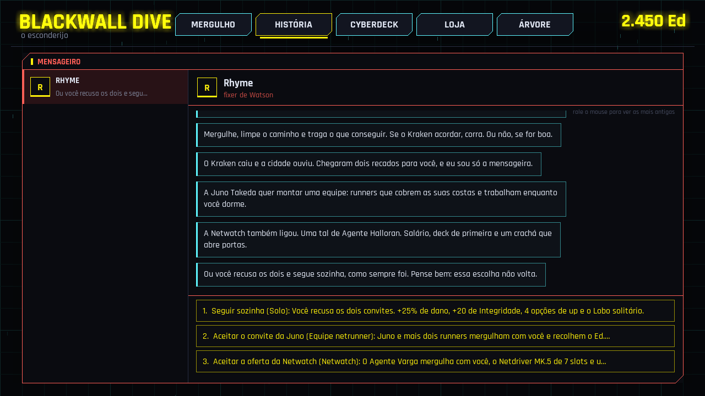

# Blackwall Dive

Um jogo de ondas (survivor-like) com progressão incremental, no ciberespaço do Cyberpunk 2077. Você é uma netrunner freelancer de Night City. Do seu esconderijo, você mergulha camada por camada até a Blackwall: sobrevive às ondas de ICE com quickhacks, monta uma build entre as ondas e volta com Ed para ficar mais forte. O nome é provisório.



## Jogar

- **O executável (Windows e Linux):** a cada envio, o GitHub Actions gera o jogo empacotado, sem precisar de Python. Para baixar: aba **Actions** → **empacotar** → a execução mais recente → **Artifacts** → `blackwall-dive-Windows`. Descompacte e abra `blackwall-dive.exe`.
  - Para ter uma versão com link fixo, envie uma tag (`git tag v0.1.0` e `git push origin v0.1.0`). O Actions publica os zips na página de **Releases**.
- **A partir do código:**

  ```bash
  pip install -r requirements.txt
  ```

  ```bash
  python main.py
  ```

O jogo salva sozinho (depois de cada mergulho e de cada compra) em `%APPDATA%\BlackwallDive` no Windows e em `~/.local/share/BlackwallDive` no Linux.

## Controles

| | |
|---|---|
| **Botão esquerdo** | o hack de movimento do deck: segurar anda (Andar, Sandevistan), clicar dá o dash ou o teleporte |
| **Teclas 1 a 7** | lançam o quickhack daquele slot no ICE sob o cursor (a mira escolhe o mais perto); a tecla do movimento também anda |
| **Botão direito** | o primeiro hack de ataque do deck |
| **Tab** | mostra a build: as tags, os bônus e o ataque automático |
| **Esc** | pausa |
| **F11** | tela cheia |
| **F2** | liga e desliga os efeitos sonoros |
| **F3** | liga e desliga a música |

## Como funciona

- **O mergulho:** cada camada tem 10 ondas, com um chefe na 10ª.
  - **As ondas:** cada uma tem uma quantidade fixa de ICE, que chegam em grupos, e só acaba quando todos caem. O HUD mostra quantos faltam. Se a onda demorar, chegam reforços.
  - **O movimento é um quickhack:** ocupa um slot e gasta RAM. Há quatro:
    - **Andar:** segurar; pouca RAM por segundo;
    - **Kerenzikov:** arrancada invulnerável;
    - **Teleporte:** some e reaparece no cursor, empurrando os ICE; funciona até paralisada;
    - **Sandevistan:** segurar; corre com o tempo lento em volta, gastando muita RAM.
  - **Integridade:** a vida. Zerou, é **flatline**: você volta com 75% do Ed do mergulho.
  - **RAM:** os hacks gastam RAM, que volta com o tempo.
  - **Ed:** cai dos ICE e é recolhido ao passar perto.
  - **Entre as ondas:** você escolhe 1 de 3 ups. Também dá para trocar as ofertas (custa Ed) ou desconectar e voltar com todo o Ed.
- **As builds:** os ups do mergulho são só números (Integridade, dano, recarga, RAM, crítico...), e cada um tem uma tag: Contágio, Sobrecarga, Cadeia ou Controle.
  - **Bônus de conjunto:** 2, 4 e 6 ups da mesma tag ligam um bônus cada.
  - **Ataque automático:** com 3 ups, a tag que você mais pegou liga o ataque dela, o único que ataca sozinho.
  - **O guia:** as ofertas seguintes puxam para a sua tag.
  - **O deck:** só aparecem ups das builds que os hacks do deck permitem.
  - **Sem prender:** a build deixa os hacks dela bem mais fortes, mas os outros continuam funcionando.
- **Os quickhacks:** os 15 do Cyberpunk 2077, de Short Circuit e Ping (os iniciais) a Blackwall Gateway e System Collapse, mais os 4 de movimento. Os novos vêm ao vencer camadas, ou da loja do esconderijo.
- **Os cyberdecks:** do Militech Paraline (3 slots) ao Militech Canto MK.6 (7 slots), contando o slot do movimento. Cada um tem um bônus.
- **As árvores (aba ÁRVORE):** pagas com Ed e válidas para todos os mergulhos. Os nós ainda bloqueados ficam ocultos até você comprar o nó de cima.
  - **Netrunner:** só números (dano, Integridade, RAM, crítico, armadura, roubo de vida...). Os nós principais vão longe, então insistir sempre ajuda.
  - **Uma árvore por quickhack:** os efeitos especiais, como mais saltos do Short Circuit, Contagion pulando para mais alvos, o Overheat que também envenena e a Execução do Cripple Movement.
- **As camadas:** são cinco, cada uma com seu chefe:
  1. a rede de Night City (Kraken);
  2. as redes corporativas (Agente Kessler, da Netwatch);
  3. a Old Net (Liche, que se reconstrói);
  4. os arredores da Blackwall (Giant);
  5. o outro lado (a IA renegada).
- **As ondas infinitas:** liberadas depois da 1ª camada. O recorde fica guardado.
- **A história (aba HISTÓRIA, no Mensageiro, como no primeiro jogo):** a Rhyme, fixer de Watson, dá o primeiro serviço. Depois da 1ª camada, ela traz dois convites, e você escolhe um dos três caminhos. Você responde escolhendo um dos três caminhos. A escolha vale uma vez por salvamento, para sempre, e só depois dela a segunda camada abre. Os serviços chegam como mensagens, e a equipe tem a própria conversa, onde você treina cada membro.
  - **Solo:**
    - +25% de dano e +20 de Integridade;
    - 4 opções de up em vez de 3;
    - o Lobo solitário: cada onda sem levar dano dá +5% de dano até o fim do mergulho.
  - **Equipe netrunner:**
    - Juno Takeda mergulha com você; Bento "Ruído" Okafor e Mira Solano entram pelas missões;
    - cada um lança hacks sozinho (dano, controle e suporte) e recolhe o Ed que cai perto;
    - fora do mergulho, inclusive com o jogo fechado (até 12 horas), a equipe rende Ed por hora;
    - os membros sobem de nível com Ed.
  - **Netwatch:**
    - o Agente Varga mergulha com você;
    - o Netdriver MK.5 tem 7 slots;
    - +12% de dano, +10 de Integridade e um salário por hora menor que a renda da equipe;
    - as missões caçam IAs e os Voodoo Boys.
  - **As missões:** três por caminho, de 5 a 7 ondas, cada uma com um objetivo:
    - aguentar até a extração;
    - proteger o download;
    - escoltar um programa;
    - destruir os nós;
    - caçar um alvo.

    Elas pagam Ed, quickhacks e membros da equipe.
  - **O fim:** a voz do outro lado da Blackwall fala com você nas camadas fundas. Cada caminho tem um final, e depois dele o jogo continua.

O desenho completo está em [docs/GDD.md](docs/GDD.md). As decisões e os números estão em [DECISIONS.md](DECISIONS.md).



## Para desenvolver

```
main.py               abre o jogo
blackwall/
  content.py          carrega e confere data/*.yaml
  sim/                as regras do mergulho, sem tela (testáveis)
    dive.py           ondas, ICE, chefes, dano, efeitos, ataques automáticos
    hacks.py          o que cada quickhack faz
    build.py          tags, bônus de conjunto, ofertas guiadas
    stats.py          os números da netrunner
    waves.py          o plano de cada onda
  meta/               o esconderijo: perfil, árvore, loja, decks, salvamento
    story.py          a quest line: falas, caminho, missões, equipe, renda
  game/               a tela em pygame: neon com brilho, efeitos, sons sintetizados
data/                 o conteúdo: hacks, ups, builds, inimigos, camadas, decks, árvore, história e os números
tests/                pytest (as regras e a interface sem janela)
tools/
  simular.py          o robô de balanceamento
  capturas.py         fotos das telas sem abrir janela
  empacotar.py        gera o executável (PyInstaller)
```

Testes:

```bash
pip install -r requirements.txt pytest
```

```bash
python -m pytest -q tests
```

O robô de balanceamento joga carreiras inteiras e mede quantos mergulhos e minutos cada camada leva:

```bash
python tools/simular.py 3 --caminho=equipe
```

Para gerar o executável localmente:

```bash
pip install -r requirements-build.txt
```

```bash
python tools/empacotar.py
```

## Créditos

- Fontes: Rajdhani e IBM Plex Mono, ambas sob a SIL Open Font License (as licenças estão em `assets/fonts/`).
- Trilha: os três loops do primeiro jogo, o projeto-netrunner (`assets/music/`). São composições originais, sintetizadas pelo `tools/make_music.py` daquele projeto:
  - `desktop_loop.wav` toca no esconderijo;
  - `malfunction_loop.wav`, nas ondas;
  - `danger_loop.wav`, com chefe ou alvo na arena.
- Efeitos sonoros: sintetizados na hora pelo jogo (`blackwall/game/audio.py`).
- Cyberpunk 2077, Night City, Netwatch e os nomes dos quickhacks, cyberdecks e Black ICE pertencem à CD PROJEKT RED e à R. Talsorian Games. Este é um projeto de fã, sem fins comerciais.
